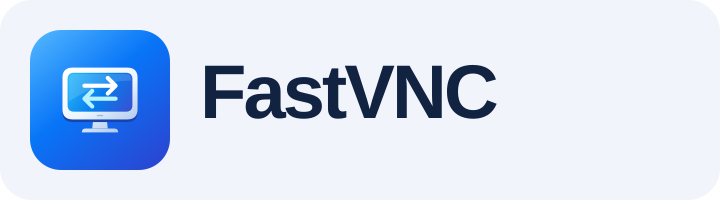

<p align="center"></img></a>


<p align="center"> <b>AVNC</b> is a VNC client for Android. </p>

-------------------------------------------------------------------------------


### Features
- Material Design (with Dark theme)
- Configurable gestures
- Virtual Keys
- Built-in computer keyboard with modifiers, symbols and function keys
- Movable floating touchpad with mouse buttons and scrolling
- VNC Repeater support
- Wake-on-LAN support
- Built-in SSH tunnel (VNC over SSH)
- Picture-in-Picture mode
- View-only mode
- No-video mode
- Automatic Server Discovery (Zeroconf)
- Import/Export servers
- Clipboard Sync with server
- `vnc://` URI support
- TLS support (AnonTLS, VeNCrypt)
- Tight encoding support


[](https://f-droid.org/packages/com.gaurav.avnc/)
[](https://play.google.com/store/apps/details?id=com.gaurav.avnc)

### Screenshots

[](metadata/en-US/images/phoneScreenshots/1.jpg)
[](metadata/en-US/images/phoneScreenshots/2.jpg)
[](metadata/en-US/images/phoneScreenshots/3.jpg)
[](metadata/en-US/images/phoneScreenshots/4.jpg)
[](metadata/en-US/images/phoneScreenshots/5.jpg)
[](metadata/en-US/images/phoneScreenshots/6.jpg)
[](metadata/en-US/images/phoneScreenshots/7.jpg)
[](metadata/en-US/images/phoneScreenshots/8.jpg)

  
Development
===========

### Touch controls

Tap the desktop to click and double-tap to double-click. Swipe with one finger to
pan the local view; swipe with two fingers to scroll the remote application in
either direction. Long press until the haptic feedback, then move to drag a window,
file or text selection; lift to release. Double-tap and hold also drags. A two-finger
tap right-clicks at the first finger's original position. Pinch to zoom. During a
drag, hold near a viewport edge to reveal more of the desktop. Quick two-finger
scrolling continues briefly after release; touch again to stop, or disable Remote
scroll inertia in Input settings. Existing saved gesture preferences are preserved;
Settings → Input → Restore recommended controls applies these defaults.

The keyboard button opens the built-in computer keyboard. Use ABC, 123 and Fn to switch pages; the 123 page includes a second symbol set. Tap a modifier for the next key, or hold it to lock;
tap it again to release. Chinese text is composed by the remote computer's input
method. Open it using the keyboard button and close it using its close button or
Back; mouse gestures never automatically open or hide it. Settings → Input → Use
Android keyboard restores the system keyboard.

Slide on the floating touchpad to move the remote pointer; tap to left-click,
double-tap to double-click, long press or double-tap and hold to drag. Two-finger
tap right-clicks; two-finger swipe scrolls in both directions with optional inertia.
Its left/right buttons remain available; hold the left button while sliding to drag.
The side strip scrolls vertically and stops on release. Drag the header to
reposition the panel, use its chevron to collapse it, or reopen it from Touchpad in
the bottom control capsule. New sessions start with just the capsule unless a
saved touchpad preference exists. More contains labeled picture, input and help
options. While typing, these controls move into the keyboard header. In landscape
windows at least 800dp wide, an enabled touchpad docks beside the keyboard and
returns to its saved floating position when the keyboard closes. Small windows
temporarily compact the panel without closing the keyboard.

### Building

Tools required:

- Git 
- Android Studio
- Android SDK
- NDK (with CMake)
- For vcpkg (depending on your platform): curl, zip, unzip, tar, pkg-config, a C++ compiler

To get started, simply clone the repo and initialize submodules:

```bash
git clone https://github.com/gujjwal00/avnc.git
cd avnc
git submodule update --init --depth 1
```

Now you can import the project in Android Studio, or build it directly from terminal.

Read [Architecture.kt](app/src/main/java/com/gaurav/avnc/Architecture.kt) (preferably in
Android Studio) to know more about the code.

> [!TIP]
> AVNC uses [vcpkg](https://learn.microsoft.com/en-us/vcpkg/) to manage C/C++ dependencies.
> `vcpkg` downloads & builds these dependencies on first run.
> So the first time you build/configure AVNC, it can take a lot of time.
> If you face an error, try adding `android.native.buildOutput=verbose` to `gradle.properties` in project root.


##
You can translate AVNC on [Weblate](https://hosted.weblate.org/engage/avnc/).

[](https://hosted.weblate.org/engage/avnc/)


## Credits

- Authors of libraries AVNC depends on (LibVNCClient, libjpeg-turbo, wolfSSL, sshlib, leakcanary etc.)
- Contributors for reporting issues, providing fixes
- Contributors for translating AVNC, and [Weblate](https://weblate.org/) for translation hosting
- [Browserstack](https://www.browserstack.com/) for providing testing infrastructure
